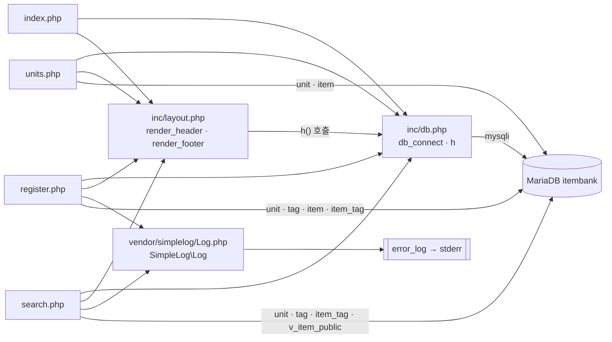

# item-bank-php 아키텍처

## 모듈 개요

- 문항 검색 · 문항 등록 · 단원 목록 화면을 제공하는 PHP 7.4 + Apache 모듈입니다(`legacy/item-bank-php/Dockerfile:1`).
- 라우터나 프레임워크 없이 PHP 파일 하나가 URL 하나를 맡습니다(`Dockerfile:14`, `.htaccess` 없음).
- DB는 `mysqli`로 MariaDB `itembank`에 접속합니다(`Dockerfile:3`, `inc/db.php:14-21`, `docker-compose.yml:40-45`).
- 호스트 포트는 8081이며 Compose 프로필은 `php`입니다(`docker-compose.yml:37-39`).
- 공통 코드는 `inc/`(DB 연결 · 이스케이프 · 레이아웃)와 `vendor/simplelog/`(로거)에만 있습니다.

> 아래 경로는 따로 표시하지 않으면 `legacy/item-bank-php/` 기준입니다.

## 폴더 구조

```
legacy/item-bank-php/
├── Dockerfile               16줄  php:7.4-apache, mysqli, 에러 로그 → stderr
├── index.php                14줄  홈(메뉴)
├── search.php              731줄  문항 검색 — 함수 4개, 모듈 코드의 약 70%
├── register.php            177줄  문항 등록 — 함수 없음, 위에서 아래로 실행
├── units.php                48줄  단원 목록 — 함수 없음
├── inc/
│   ├── db.php               37줄  db_connect(), h()
│   └── layout.php           43줄  render_header(), render_footer()
└── vendor/
    └── simplelog/Log.php    54줄  SimpleLog\Log (error_log 래퍼, "수정하지 말 것" — Log.php:3)
```

## 진입점 표

Apache가 `/var/www/html/`의 파일을 그대로 실행합니다(`Dockerfile:14`). `a2enmod rewrite`가 켜져 있지만(`Dockerfile:4`) `.htaccess`가 없어서 URL을 바꿔 쓰는 규칙은 없습니다.

| URL · 화면 | 처음 실행되는 파일 | 요청 방식 | 부르는 주요 함수 (호출 순서대로) |
|---|---|---|---|
| `/` 또는 `/index.php` · 홈(메뉴) | `index.php` | GET | `render_header('홈')` `index.php:5` → `render_footer()` `index.php:14`. DB 접속 없음(`db.php`를 포함만 함, `index.php:2`) |
| `/search.php` · 문항 검색 | `search.php` | GET (`search.php:632`) | `Log::setThreshold` `:27` → `render_header` `:709` → `db_connect` `:713` → `buildSearchQuery($_GET, $conn)` `:722` → `renderSearchForm` `:723` → `runSearchQuery` `:724` → `renderResultTable` `:725` → `render_footer` `:731`. 실패하면 `Log::error` `:727` |
| `/register.php` · 문항 등록 | `register.php` | GET은 폼 표시, POST는 등록 (`register.php:40`, `:141`) | `db_connect` `:17` → 단원 · 태그 목록 조회 `:27`, `:34` → (POST일 때) 입력 검증 `:49-81` → 트랜잭션 안에서 INSERT `:85-114` → `Log::info` `:115` 또는 `Log::error` `:121` → `render_header` `:127` → 폼 출력 → `render_footer` `:177` |
| `/units.php` · 단원 목록 | `units.php` | GET | `render_header` `:5` → `db_connect` `:8` → 단원별 공개 문항 수 조회 `:16-20` → 표 출력 → `render_footer` `:48` |

- 메뉴 링크 3개는 `index.php:9-11`과 `inc/layout.php:10-12`에 같은 내용으로 두 번 정의돼 있습니다.
- `search.php`의 GET 파라미터: `q`, `unit`, `level`, `tag`, `sort`, `dir`, `page` (`search.php:5-12`, 실제로 읽는 곳은 `:53-80`)
- `register.php`의 POST 필드: `title`, `stem`, `unit_id`, `level`, `tags[]` (`register.php:41-45`)

## 의존 관계

화살표는 "A → B (A가 B를 포함하거나 호출)"입니다.



### 파일 포함 (`require_once`)

| 포함하는 파일 | 포함되는 파일 | 근거 |
|---|---|---|
| `index.php` | `inc/db.php` | `index.php:2` |
| `index.php` | `inc/layout.php` | `index.php:3` |
| `units.php` | `inc/db.php` | `units.php:2` |
| `units.php` | `inc/layout.php` | `units.php:3` |
| `register.php` | `inc/db.php` | `register.php:2` |
| `register.php` | `inc/layout.php` | `register.php:3` |
| `register.php` | `vendor/simplelog/Log.php` | `register.php:4` |
| `search.php` | `inc/db.php` | `search.php:20` |
| `search.php` | `inc/layout.php` | `search.php:21` |
| `search.php` | `vendor/simplelog/Log.php` | `search.php:22` |

`inc/`와 `vendor/` 파일은 다른 파일을 포함하지 않습니다(`inc/db.php`, `inc/layout.php`, `Log.php` 전체를 확인).

### 함수 호출 (다른 파일에 정의된 함수)

| 호출하는 쪽 | 호출되는 함수 (정의 위치) | 근거 |
|---|---|---|
| 모든 페이지 | `render_header` · `render_footer` (`inc/layout.php:7`, `:38`) | `index.php:5,14`, `units.php:5,11,23,48`, `register.php:19,21,127,177`, `search.php:709,717,731` |
| `units.php`, `register.php`, `search.php` | `db_connect` (`inc/db.php:7`) | `units.php:8`, `register.php:17`, `search.php:713` |
| 모든 페이지 | `h` (`inc/db.php:34`) | 예: `units.php:40`, `register.php:131`, `search.php:360` |
| `inc/layout.php` | `h` (`inc/db.php:34`) | `inc/layout.php:17,33` |
| `register.php` | `SimpleLog\Log::info` · `Log::error` | `register.php:115,121` |
| `search.php` | `SimpleLog\Log::setThreshold` · `debug` · `error` | `search.php:27,103,528,537,727` |
| `SimpleLog\Log` | PHP 내장 `error_log()` → stderr | `vendor/simplelog/Log.php:52`, `Dockerfile:10` |

- `inc/layout.php`는 `h()`를 쓰면서 `inc/db.php`를 직접 포함하지 않습니다. 그래서 부르는 쪽이 `db.php`를 먼저 포함해야 동작합니다. 현재 네 페이지는 모두 `db.php`를 먼저 포함합니다(위 포함 표의 줄 번호 참고).

### `search.php` 안의 함수 호출

| 호출하는 쪽 | 호출되는 함수 | 근거 |
|---|---|---|
| 최상위 코드 | `buildSearchQuery` → `renderSearchForm` → `runSearchQuery` → `renderResultTable` | `search.php:722-725` |

- 네 함수는 서로를 부르지 않고, 최상위 코드가 `$built` 배열을 차례로 넘겨줍니다.
- `buildSearchQuery`는 SQL을 조립하는 도중에 DB를 직접 조회합니다(`search.php:125`, `:156`, `:178`).

### DB 의존 (테이블 · 뷰 이름만 코드에서 확인)

| 파일 | 테이블 · 뷰 | 근거 |
|---|---|---|
| `search.php` | `unit` | `search.php:125`, `:156` |
| `search.php` | `tag` | `search.php:178` |
| `search.php` | `item_tag`, `tag` | `search.php:244` |
| `search.php` | `v_item_public` | `search.php:522` |
| `register.php` | `unit` | `register.php:27` |
| `register.php` | `tag` | `register.php:34` |
| `register.php` | `item` | `register.php:87`, `:93` |
| `register.php` | `item_tag` | `register.php:105` |
| `units.php` | `unit`, `item` | `units.php:16-18` |

## 가장 긴 함수 3개

| 순위 | 파일 | 함수 | 시작–끝 | 길이 | 하는 일 |
|---|---|---|---|---|---|
| 1 | `search.php` | `buildSearchQuery` | `:42`–`:564` | 523줄 | GET 파라미터를 검증하고 WHERE · ORDER BY · LIMIT SQL을 조립합니다. 선택 목록 조회, 요약 · 경고 · 폼 · 정렬 링크 HTML까지 만들어 배열 하나로 돌려줍니다(`:541-563`) |
| 2 | `search.php` | `renderResultTable` | `:647`–`:704` | 58줄 | 경고 · 요약, 건수, 결과 표, 페이지 링크를 출력합니다. 0건이면 안내 문구만 출력합니다(`:657-660`) |
| 3 | `search.php` | `runSearchQuery` | `:571`–`:624` | 54줄 | 같은 바인딩 값으로 COUNT 쿼리와 목록 쿼리를 차례로 실행해 `total` · `rows`를 돌려줍니다 |

- 참고로 4위는 `inc/layout.php`의 `render_header`(`:7`–`:36`, 30줄)입니다.
- `register.php`와 `units.php`에는 함수가 없고, 모든 코드가 파일 최상위에서 위에서 아래로 실행됩니다.

## 미확인 목록

- `v_item_public` 뷰의 정의(공개 조건, `tag_names`를 만드는 방식): `db/mariadb/init/*.sql`을 아직 열지 않았습니다.
- `item.status` 값의 전체 목록: 코드에서는 `A`(`units.php:17`)와 `R`(`register.php:84,94`)만 확인했습니다.
- 실행 중인 컨테이너의 실제 응답: 컨테이너를 띄워 보지 않았습니다.
- 다른 시스템(Thymeleaf 모듈 등)이 이 PHP 페이지를 링크하거나 호출하는지: 이 모듈 밖은 찾아보지 않았습니다.
- 난이도를 비웠을 때의 조건이 의도한 것인지: 주석은 "1~5 모두 포함"이라고 하는데 코드는 `AND level < 5`를 붙입니다(`search.php:213-216`). 이 때문에 난이도 5인 문항이 빠집니다. 원래 의도인지 버그인지는 비즈니스 규칙 단계에서 확인해야 합니다.
