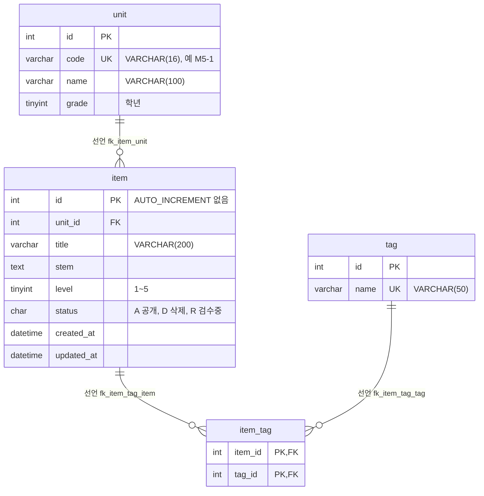
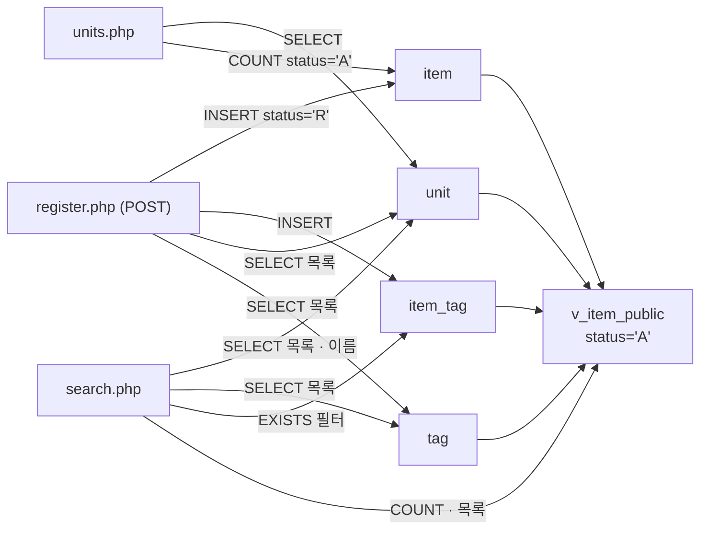

# item-bank-php 데이터 흐름 · ERD

> 모듈 구조와 진입점은 [ARCHITECTURE.md](./ARCHITECTURE.md) 를 봅니다.
> 경로는 따로 표시하지 않으면 `legacy/item-bank-php/` 기준입니다. 스키마 파일은 `db/mariadb/init/01-schema.sql` 이며 아래에서는 `schema.sql` 로 줄여 씁니다.

## 조사 범위

- 읽은 파일: `index.php`, `search.php`, `register.php`, `units.php`, `inc/db.php`, `inc/layout.php`, `db/mariadb/init/01-schema.sql`
- 이 모듈에는 스키마 정의 · 마이그레이션 파일이 없습니다. 테이블 정의는 모두 `schema.sql` 에서 확인했습니다.
- 이 모듈이 쓰는 DB 객체는 테이블 4개(`unit`, `item`, `tag`, `item_tag`)와 뷰 1개(`v_item_public`)입니다. 같은 DB 에 있는 `class` · `assignment` · `distribution` · `submission`(`schema.sql:75-115`)은 이 모듈 코드에 나오지 않아 제외했습니다.

## 1. 테이블 목록

| 테이블 | 주요 컬럼 | 키 · 제약 | 근거 |
|---|---|---|---|
| `unit` (단원) | `id` INT, `code` VARCHAR(16), `name` VARCHAR(100), `grade` TINYINT | PK `id`, UNIQUE `code`(`uk_unit_code`) | `schema.sql:11-18` |
| `item` (문항) | `id` INT, `unit_id` INT, `title` VARCHAR(200), `stem` TEXT, `level` TINYINT(주석 "1~5"), `status` CHAR(1) 기본값 `'A'`(주석 "A=공개 D=삭제 R=검수중"), `created_at` DATETIME, `updated_at` DATETIME | PK `id`(AUTO_INCREMENT 없음), 인덱스 `unit_id` · `level`, FK `unit_id → unit.id` | `schema.sql:20-33` |
| `tag` (태그) | `id` INT, `name` VARCHAR(50) | PK `id`, UNIQUE `name`(`uk_tag_name`) | `schema.sql:35-40` |
| `item_tag` (문항–태그 연결) | `item_id` INT, `tag_id` INT | 복합 PK (`item_id`, `tag_id`), FK `item_id → item.id`, FK `tag_id → tag.id` | `schema.sql:42-48` |

### 뷰

| 뷰 | 컬럼 | 원본 · 조건 | 근거 |
|---|---|---|---|
| `v_item_public` | `id`, `unit_id`, `unit_code`, `unit_name`, `unit_grade`, `title`, `stem`, `level`, `created_at`, `updated_at`, `tag_names` | `item JOIN unit ON u.id = i.unit_id`, `WHERE i.status = 'A'`. `tag_names` 는 `item_tag JOIN tag` 의 `t.name` 을 `t.id` 순서로 `,` 로 이은 상관 서브쿼리(태그가 없으면 NULL) | `schema.sql:52-70` |

- `item.id` 는 AUTO_INCREMENT 가 아니어서 `register.php` 가 `MAX(id)+1` 을 직접 계산합니다(`schema.sql:21`, `register.php:87`).
- 외래 키에 `ON DELETE` · `ON UPDATE` 절이 없습니다(`schema.sql:32`, `:46-47`). 부모 행 삭제 시 동작은 MariaDB 기본값을 따릅니다.

## 2. 테이블 관계

코드의 JOIN · 서브쿼리에서 찾은 관계는 모두 외래 키로 선언된 관계와 같았습니다. 외래 키 없이 코드에서만 추정되는 관계는 찾지 못했습니다. 그래서 아래 관계는 모두 "선언"이며, 코드에서도 같은 조인을 쓰는 위치를 함께 적었습니다.

| 관계 | 구분 | 선언 근거 | 코드에서 같은 조인을 쓰는 곳 |
|---|---|---|---|
| `unit` 1 : N `item` (`item.unit_id → unit.id`) | 선언 | `schema.sql:32` | `schema.sql:69`(뷰), `units.php:17`(상관 서브쿼리 `i.unit_id = u.id`) |
| `item` 1 : N `item_tag` (`item_tag.item_id → item.id`) | 선언 | `schema.sql:46` | `schema.sql:67`(뷰), `search.php:245`(`it.item_id = v_item_public.id`), `register.php:105`(INSERT) |
| `tag` 1 : N `item_tag` (`item_tag.tag_id → tag.id`) | 선언 | `schema.sql:47` | `schema.sql:66`(뷰), `search.php:244`(`JOIN tag t ON t.id = it.tag_id`) |

- `item` : `tag` 는 `item_tag` 를 통한 N : M 입니다.
- 문항에 태그가 0개일 수 있습니다. 등록 화면은 태그를 고르지 않으면 `item_tag` INSERT 를 건너뜁니다(`register.php:104`). 그래서 `item ||--o{ item_tag` 로 표시했습니다.
- 한 단원에 문항이 0개인 경우는 코드가 허용합니다(`units.php:17` 는 COUNT 가 0 인 단원도 목록에 나옵니다). 그래서 `unit ||--o{ item` 로 표시했습니다.

## 3. 읽기 · 쓰기 위치

`register.php` · `units.php` 에는 함수가 없어서 "최상위 코드"로 적었습니다. `search.php` 의 검색 SQL 은 `buildSearchQuery` 가 문자열로 조립하고 `runSearchQuery` 가 실행합니다. 두 곳을 모두 적었습니다.

### `unit`

| 구분 | 파일 · 함수 | 쿼리 요약 | 근거 |
|---|---|---|---|
| SELECT | `units.php` 최상위 코드 | `id, code, name, grade` + 단원별 공개 문항 수, `ORDER BY grade, code` | `units.php:16-20` |
| SELECT | `register.php` 최상위 코드 | 단원 선택 목록 `id, code, name`, `ORDER BY grade, code` | `register.php:27` |
| SELECT | `search.php` `buildSearchQuery` | 요약에 쓸 단원 이름 `name, grade WHERE code = ?` | `search.php:125` |
| SELECT | `search.php` `buildSearchQuery` | 단원 선택 목록 `code, name, grade`, `ORDER BY grade, code` | `search.php:156` |
| SELECT (뷰 경유) | `search.php` `runSearchQuery` | `v_item_public` 의 `unit_code` 로 필터 · 정렬 · 출력 | 조립 `search.php:118`, `:521-522`, 실행 `:577`, `:600` |
| INSERT · UPDATE · DELETE | 없음 | — | 모듈 전체 SQL 검색 결과 |

### `item`

| 구분 | 파일 · 함수 | 쿼리 요약 | 근거 |
|---|---|---|---|
| SELECT | `units.php` 최상위 코드 | `COUNT(*) WHERE unit_id = u.id AND status = 'A'` | `units.php:17` |
| SELECT | `register.php` 최상위 코드 (POST, 트랜잭션 안) | `COALESCE(MAX(id), 0) + 1 ... FOR UPDATE` 로 다음 ID 계산 | `register.php:85-90` |
| SELECT (뷰 경유) | `search.php` `runSearchQuery` | `v_item_public` 에서 `title`·`stem` LIKE, `level`, 정렬(`id`·`title`·`level`·`created_at`) | 조립 `search.php:98`, `:215-226`, `:275-325`, `:521-526`, 실행 `:577`, `:600` |
| INSERT | `register.php` 최상위 코드 (POST, 트랜잭션 안) | `INSERT INTO item (...) VALUES (?, ?, ?, ?, ?, 'R', NOW(), NOW())` — 항상 `status = 'R'` | `register.php:92-101` |
| UPDATE · DELETE | 없음 | — | 모듈 전체 SQL 검색 결과 |

### `tag`

| 구분 | 파일 · 함수 | 쿼리 요약 | 근거 |
|---|---|---|---|
| SELECT | `register.php` 최상위 코드 | 태그 선택 목록 `id, name ORDER BY id` | `register.php:34` |
| SELECT | `search.php` `buildSearchQuery` | 태그 선택 목록 `name ORDER BY id` | `search.php:178` |
| SELECT (서브쿼리) | `search.php` `runSearchQuery` | 태그 필터 `EXISTS (... JOIN tag t ... t.name = ?)` | 조립 `search.php:244-245`, 실행 `:577`, `:600` |
| SELECT (뷰 경유) | `search.php` `runSearchQuery` | `v_item_public.tag_names` 출력 | `search.php:521`, `:678` |
| INSERT · UPDATE · DELETE | 없음 | — | 모듈 전체 SQL 검색 결과 |

### `item_tag`

| 구분 | 파일 · 함수 | 쿼리 요약 | 근거 |
|---|---|---|---|
| SELECT (서브쿼리) | `search.php` `runSearchQuery` | 태그 필터 `EXISTS (SELECT 1 FROM item_tag it ... WHERE it.item_id = v_item_public.id ...)` | 조립 `search.php:244-245`, 실행 `:577`, `:600` |
| SELECT (뷰 경유) | `search.php` `runSearchQuery` | `v_item_public.tag_names` 계산 | `schema.sql:64-67`, `search.php:521` |
| INSERT | `register.php` 최상위 코드 (POST, 트랜잭션 안) | 선택한 태그마다 `INSERT INTO item_tag (item_id, tag_id) VALUES (?, ?)` | `register.php:104-113` |
| UPDATE · DELETE | 없음 | — | 모듈 전체 SQL 검색 결과 |

### `v_item_public` (뷰)

| 구분 | 파일 · 함수 | 쿼리 요약 | 근거 |
|---|---|---|---|
| SELECT | `search.php` `runSearchQuery` | 총 건수 `SELECT COUNT(*) AS cnt FROM v_item_public WHERE ...` | 조립 `search.php:526`, 실행 `:577-597` |
| SELECT | `search.php` `runSearchQuery` | 목록 `SELECT id, title, unit_code, level, tag_names, created_at ... LIMIT 20 OFFSET <정수>`(OFFSET 은 바인딩이 아니라 `(int)` 로 이어 붙임, `search.php:523`) | 조립 `search.php:521-525`, 실행 `:600-621` |

### 흐름 요약

- 등록한 문항은 `status = 'R'` 로 들어가고(`register.php:94`), 검색(`v_item_public`, `schema.sql:70`)과 단원별 문항 수(`units.php:17`)는 `status = 'A'` 만 봅니다. 따라서 이 모듈 안에서는 새로 등록한 문항이 검색 · 단원 목록에 나오지 않습니다.
- 모듈 안의 쓰기는 `register.php` 한 곳뿐이며, `item` · `item_tag` INSERT 를 한 트랜잭션으로 묶습니다(`register.php:85`, `:114`, `:120`).

## 4. 미확인

- `item.status` 를 `R` → `A`(검수 완료) 또는 `D`(삭제)로 바꾸는 코드: 이 모듈에는 `UPDATE` · `DELETE` 문이 없습니다. 다른 모듈(`assignment-thymeleaf`, `grade-mssql`, `modern/api`)이나 수동 SQL 에서 바꾸는지는 확인하지 않았습니다. `assignment-thymeleaf` 는 `unit` 을 읽는 곳 하나만 봤습니다(`legacy/assignment-thymeleaf/src/main/java/com/example/assign/dao/AssignmentDao.java:24`).
- `item.status` 에 실제로 들어 있는 값: 스키마 주석(`schema.sql:26`)은 `A` · `D` · `R` 이라고 하지만 CHECK 제약은 없습니다. 시드 데이터(`db/mariadb/init/02-seed.sql`)는 열어 보지 않았습니다.
- `item.updated_at` 을 읽는 곳: 등록 시 `NOW()` 로 쓰기만 하고(`register.php:94`), 검색은 이 컬럼을 SELECT 하지 않습니다(`search.php:521`). 이 모듈 밖에서 읽는지는 확인하지 않았습니다.
- `v_item_public` 의 `unit_name` · `unit_grade` · `stem`(출력용) 컬럼을 쓰는 곳: 이 모듈의 SELECT 목록에는 없습니다(`search.php:521`). `stem` 은 WHERE 의 LIKE 에만 씁니다(`search.php:98`).
- 실제 DB 의 스키마가 `schema.sql` 과 같은지: 컨테이너를 띄워 `SHOW CREATE TABLE` 로 확인하지 않았습니다.
- 외래 키 없이 코드에서만 쓰는 관계: 찾지 못했습니다. "없다"가 아니라 이 모듈의 SQL 범위 안에서 발견되지 않았다는 뜻입니다.
